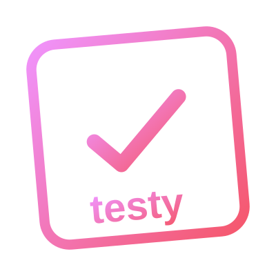

<p align="center">
  
</p>

<p align="center">
  <strong>English</strong> · <a href="README.pt-BR.md">Português (BR)</a>
</p>

# Testy

A testy, opinionated test management tool for QA teams that value simplicity over configuration. Create test plans, write scenarios in Given/When/Then format, generate scenarios with AI, attach evidence, and export PDF reports — nothing more, nothing less.

Most test management tools drown you in fields, workflows, and integrations before you can write your first test case. Testy takes the opposite approach: it gives you exactly what you need and stays out of the way.

## Features

- **Test Plans** — group related scenarios under a named plan assigned to a QA
- **Tags** — categorize plans with tags (e.g. "login", "sprint-23", "regressão") and search by them
- **Scenarios (Given/When/Then)** — structured Gherkin format without the overhead of a full framework
- **AI Scenario Generation** — describe a feature in plain text and let an AI (Gemini, ChatGPT, Claude via API, or the Claude Code already signed in on the machine) generate 5-15 test scenarios automatically, covering happy paths, edge cases, boundary values, and equivalence partitioning
- **Drag & Drop Reorder** — reorder scenarios by dragging them, with smooth FLIP animations and a visual drop zone; order is persisted and reflected in reports
- **Evidence Attachments** — upload screenshots and files directly on each scenario or bug, each with an optional caption that shows up in the PDF
- **One-Click Approve/Reject** — mark scenarios as approved or failed inline
- **Derived Status** — plan status is computed automatically from its scenarios (no manual updates)
- **Projects (workspaces)** — one workspace per application under test; after signing in you pick a project and its test plans, bugs, root causes and AI analyses stay separate from the others (the API takes `project_id`)
- **Bug Tracking** — report bugs with title, description, steps to reproduce, obtained vs expected results, and evidence attachments; tag by feature and root cause; mark as open or resolved
- **AI for bugs** — paste a bug report in free text and the AI fills in the bug form (steps, results, tags reusing the existing ones) for review; on The Root Of All Evil, "Analyze bugs" reads the most frequent bugs and reports the recurring errors and what to improve; each analysis is saved and exports to a LaTeX PDF
- **Bug ↔ Scenario Link** — associate failed scenarios with bugs; a scenario cannot be approved while a bug is linked to it
- **Root Causes Dashboard** — aggregated view of bugs grouped by cause tag and feature tag, with bar charts for quick analysis
- **Search & Filters** — search plans by name, QA, or tag; search bugs by ID, title, or description; filter by status, tags, and date range
- **Pagination** — paginated plan and bug listings for large datasets
- **PDF Reports (LaTeX)** — export test plans, individual bugs and AI bug analyses as LaTeX PDFs (Latin Modern), with a global logo and in the language the app is in
- **Keyboard Shortcuts** — navigate quickly with single-key shortcuts (T for the menu, W for projects, N for new, B for back, R for root causes, P for plans)
- **Authentication & Roles** — username/password login with admin and regular user roles; admins manage all plans and bugs, users manage their own
- **Bilingual (EN / PT-BR)** — full interface in English and Brazilian Portuguese; switch languages with one click, preference saved in cookie
- **REST API** — full JSON API with token authentication for test plans, scenarios, bugs, tags, and screenshot attachments
- **Testy CLI** — command-line client for people and AI agents: manage projects, test plans and scenarios, report bugs with reproduction steps and screenshots, each repository tied to its workspace (`.testy.json`); optional AI mode runs scenarios in the browser with Playwright

## Tech Stack

| Layer | Choice |
|-------|--------|
| Framework | Rails 8.1 |
| Ruby | 3.4+ |
| Database | SQLite |
| Frontend | Vanilla CSS, Hotwire (Turbo + Stimulus) |
| File Storage | Active Storage (local disk) |
| PDF | LaTeX (pdflatex) |
| AI | Gemini, OpenAI (ChatGPT), Anthropic (Claude) or local Claude Code CLI |
| CLI | Go (Cobra) + Claude Code (AI mode) |
| Browser Automation | Playwright MCP |
| Deploy | Kamal-ready (Docker + Thruster) |

## Getting Started

**Prerequisites:** Ruby 3.4+ and `pdflatex` for the PDF reports (Debian/Ubuntu: `texlive-latex-extra lmodern`; macOS: MacTeX)

```bash
# Clone the repository
git clone https://github.com/VictorBitancourt/testy.git
cd testy

# Install dependencies
bundle install

# Setup an empty database (db:setup/db:prepare also load the seed's sample data)
bin/rails db:create db:schema:load

# (Optional) AI scenario generation: pick the provider and paste its key in Settings,
# or use environment variables (AI_PROVIDER=gemini|openai|anthropic|claude_cli).
# claude_cli needs no key: it runs `claude -p` with Claude Code's existing login.
export GEMINI_API_KEY=your_key_here   # or OPENAI_API_KEY / ANTHROPIC_API_KEY

# Start the server
bin/dev
```

**macOS:** `bash bin/setup-mac` installs Homebrew, rbenv, the Ruby from `.ruby-version`, the gems and (optionally) MacTeX, then creates the database. Safe to run again.

Open [http://localhost:3000](http://localhost:3000). On first access, you'll be prompted to create the admin user. After signing in you land on **Projects**: create one per application and click it to open its test plans.

## Running Tests

```bash
bin/rails test          # unit, controller and integration tests (PDF tests need pdflatex)
bin/rails test:system   # browser smoke tests (needs Chrome/Chromium)
```

Covers models, controllers, authentication, authorization, filters, projects, AI providers and the LaTeX reports.

## Testy CLI

`testy` is a command-line client for the Testy API. Use it by hand or let an AI agent (Claude Code, for example) drive it from any repository: list and create test plans and scenarios, report bugs with step-by-step reproduction and screenshots, all inside the right project (workspace).

### Prerequisites

| Requirement | Purpose |
|---|---|
| Go 1.26+ (or the pre-built `cli/bin/testy`) | Build the CLI |
| A running Testy server and a user account | Every command talks to its API |
| [Claude Code](https://docs.anthropic.com/en/docs/claude-code), Node.js and Chromium | Only for `testy qa` (see the end of this section) |

### Install

```bash
# Build (the binary is also committed at cli/bin/testy)
cd cli && make build && cd ..

# Put it on your PATH, so it works from any repository
ln -s "$PWD/cli/bin/testy" ~/.local/bin/testy

# Point it at the server (default: http://localhost:3000)
export TESTY_BASE_URL=http://192.168.1.20:3000

# Log in — the API token is saved in ~/.config/testy/token
testy login victor 's3cret-pass'
testy whoami
testy doctor        # checks token, API, selected project and skill
```

Inside this repository you can also call `bin/testy`, a wrapper that forwards to the same binary.

### Projects (workspaces)

Test plans and bugs belong to a project — one per application under test. Every `plans` and `bugs` command works on the **selected project**:

```bash
testy projects list                                  # id, name, plan and open-bug counts
testy projects create "Web Shop" --description "Storefront and checkout"
testy projects create "Mobile App" --use             # create and select it
testy projects use "Web Shop"                        # select by name (case-insensitive)...
testy projects use 3                                 # ...or by id
testy projects current                               # which project, and where the choice came from
testy projects use --clear                           # forget the selection
```

**Tie a repository to its project.** Run this at the repository root and commit the file:

```bash
cd ~/code/web-shop
testy projects use "Web Shop" --local                # writes .testy.json
cat .testy.json
# {
#   "project": "Web Shop"
# }
```

From then on, any `testy` command run anywhere inside `~/code/web-shop` (subfolders included) uses "Web Shop" — including the commands an AI agent runs there.

The project is resolved in this order (first one wins):

1. `--project <id|name>` (or `-p`) on the command: `testy bugs list -p "Mobile App"`
2. `TESTY_PROJECT` environment variable: `TESTY_PROJECT=3 testy plans list`
3. The nearest `.testy.json`, from the current directory up
4. `testy projects use` (saved in `~/.config/testy/config.json`)

With nothing selected and a single project on the server, that project is used. With several, `plans create` / `bugs create` fail and ask you to pick one, and `plans list` / `bugs list` show every project.

### Test plans and scenarios

```bash
testy plans list
testy plans list --status failed                     # approved, failed, in_progress, not_started
testy plans list --search "checkout" --date-from 2026-11-01 --date-until 2026-11-30
testy plans show 12                                  # the plan with all its scenarios
testy plans create "Checkout — guest purchase" --qa "Victor" --tags "checkout,regression"
testy plans update 12 --name "Checkout — guest and logged-in" --tags "checkout"
testy plans delete 12

testy scenarios create "Pay with a valid card" --plan 12 \
  --given "A guest has one product in the cart" \
  --when "They pay with card 4242 4242 4242 4242" \
  --then "The order confirmation page shows the order number"
testy scenarios update 57 --plan 12 --status approved   # pending, approved, failed
testy scenarios update 58 --plan 12 --status failed --bug-id 31
testy scenarios delete 59 --plan 12
testy screenshots attach --plan 12 --scenario 57 --file evidence/order-confirmed.png
```

### Bugs

A complete bug report — the description, the exact steps, what happened and what should have happened, then the screenshots:

```bash
testy bugs create "Pay button does nothing after changing the shipping address" \
  --description "On checkout, after the shipping address is edited, clicking Pay neither submits nor shows an error." \
  --steps $'1. Go to /products/42 and click "Add to cart"\n2. Open /checkout as a guest\n3. Fill in the address and click "Continue"\n4. Click "Edit address", change the ZIP code to 01310-100 and save\n5. Click "Pay"' \
  --obtained "Nothing happens; the console logs: TypeError: cart.total is undefined" \
  --expected "The payment is submitted and the confirmation page opens" \
  --feature-tag "checkout" --cause-tag "javascript"
# → prints the new bug; say its id is 31

testy bugs attach 31 --file evidence/step4-address-edited.png --file evidence/step5-pay-clicked.png
testy bugs show 31                                   # fields + attached evidence files
```

`$'...'` makes the shell turn `\n` into real line breaks, so each step shows on its own line.

```bash
testy bugs list --status open                        # open or resolved
testy bugs list --feature-tag checkout --search "pay"
testy bugs update 31 --status resolved
testy bugs delete 31
testy tags list --search "check"
```

`bugs attach` accepts PNG, JPEG, GIF, WebP and PDF. It checks every file exists before uploading any.

### Output and exit codes

| Flag | Output |
|---|---|
| (none) / `--md` | Human-readable tables |
| `--json` / `-j` | `{"ok": true, "data": ..., "summary": ...}` envelope |
| `--quiet` / `-q`, `--agent` | Only the `data` part, as JSON — handy for scripts |

```bash
BUG_ID=$(testy bugs create "Search ignores accents" --description "Searching 'cafe' does not find 'café'" -q | jq .id)
testy bugs attach "$BUG_ID" --file search.png
```

Errors keep the same format and set the exit code: `0` success, `2` usage (missing argument, no project selected, unreadable file), `3` not found, `4` not logged in or bad token, `5` forbidden (you can only change your own plans and bugs unless you are an admin), `6` rate limit, `7` network, `8` validation or server error.

### Using it from an AI agent in another project

To let a Claude Code agent working in one of your repositories explore the app with Playwright and report the bugs it confirms to that repository's workspace:

1. Install `testy` on your PATH and log in (see **Install**).
2. Tie the repository to its project: `testy projects use "Web Shop" --local`, then commit `.testy.json`.
3. Give the agent the CLI reference: `testy skill install` writes it to `~/.claude/skills/testy/SKILL.md` (it is refreshed automatically when the CLI version changes).
4. Add the Playwright MCP to that repository: `claude mcp add playwright -- npx @playwright/mcp@latest`.
5. Describe the workflow in a Markdown file in the repository (exploration rules, when a bug counts as confirmed, naming of screenshots), and point the agent to it.

A token in the environment works too, for CI or containers: `TESTY_API_TOKEN=<token> testy bugs list`.

### AI mode (`testy qa`)

`testy qa` starts Claude Code with Testy's own prompts and the Playwright MCP from this repository's `.claude/mcp.json` (run `npm install` first):

```bash
testy qa generate --url http://localhost:4000 --name "Checkout" --depth quick --user demo --pass demo123
testy qa execute  --plan 12 --url http://localhost:4000 --user demo --pass demo123
testy qa full     --url http://localhost:4000 --name "Checkout" --context "Card 4242 4242 4242 4242 always approves" --model opus
```

`generate` and `full` create the plan in the selected project; `execute` reports bugs in the plan's own project.

### Other commands

```bash
testy commands       # every command with its flags
testy logout         # revoke and remove the saved token
testy version
testy skill          # print the agent skill (SKILL.md)
```

### Environment variables

| Variable | Default | Description |
|---|---|---|
| `TESTY_BASE_URL` | `http://localhost:3000` | Testy server URL (or `--url`) |
| `TESTY_API_TOKEN` | — | API token; used instead of `~/.config/testy/token` |
| `TESTY_PROJECT` | — | Project id or name; overrides `.testy.json` and `testy projects use` |
| `XDG_CONFIG_HOME` | `~/.config` | Where the `testy/` config folder lives |

## How It Works

### Data Model

```
User (username, password_digest, role)
  |
  +-- Session (user_agent, ip_address)

Project (name, description) — one workspace per application
  |
  +-- TestPlan (name, qa_name)
  |     |
  |     +-- TestScenario (title, given, when, then, status, position)
  |     |     |
  |     |     +-- Evidence Files (Active Storage)
  |     |     |
  |     |     +-- Bug (optional link)
  |     |
  |     +-- Tags (many-to-many via TestPlanTag)
  |
  +-- Bug (title, description, steps_to_reproduce, obtained_result, expected_result, status)
  |     |
  |     +-- Evidence Files (Active Storage)
  |     |
  |     +-- feature_tag, cause_tag (free-form tags with autocomplete)
  |     |
  |     +-- TestScenarios (linked failed scenarios)
  |
  +-- BugAnalysis (AI summary, common errors, recommendations)

Setting (report logo, AI provider/model, encrypted API keys) — global
```

### Derived Status

Plan status is not a stored field. It's computed from the scenarios:

| Status | Rule |
|--------|------|
| Not Started | Plan has zero scenarios |
| Approved | All scenarios are `approved` |
| Failed | At least one scenario is `failed` |
| In Progress | Has scenarios, none failed, but not all approved |

A scenario cannot be approved while it has a bug linked to it — the bug must be unlinked or resolved first.

### PDF Export

Each plan has an "Export PDF Report" button that builds the "Evidência de Execução de Testes" document in LaTeX (Latin Modern font) and compiles it with `pdflatex`:
- Cover with the global logo, responsible QA, scenario count, story (plan name) and status: approved only when every scenario is approved, failed as soon as one fails, pending otherwise
- Every scenario with Given/When/Then and its status in bold (red when failed), plus the linked bug when there is one
- Each evidence image on its own page, with the caption typed under it in the app (or the file name). PNG, JPG and PDF are embedded; GIF and WebP show as "unsupported format"

Templates live in `lib/templates/` (`evidence_report.tex`, `bug_report.tex`, `bug_analysis_report.tex`); Testy only replaces their `% testy:...` lines. Labels come from `config/locales/*/reports.yml`, so reports follow the language the app is in. The cover logo is set by an admin under **Settings** (JPG or PNG) and applies to every PDF. `/test_plans/:id/report.tex` and `/bugs/:id/report.tex` download the generated `.tex`.

Requires `pdflatex` with `lmodern`, `tcolorbox`, `xurl`, `lastpage` and `fancyhdr` (Debian/Ubuntu: `texlive-latex-extra lmodern`; macOS: MacTeX). Set `PDFLATEX` to use another binary.

Bugs have their own PDF in the same style: cover (reporter, date, feature, root cause, open/resolved), description, steps to reproduce, obtained and expected results, associated scenarios and captioned evidence.

Each AI bug analysis (The Root Of All Evil → "Analyze bugs") also exports to PDF: summary, top causes and features as bar charts, common errors with the bugs behind them, and recommendations.

## Design Decisions

**No AND between Given, When, and Then.** This is intentional. Each step is a single text field — there's no way to chain multiple clauses with AND.

When tools allow AND, scenarios inevitably turn into click-by-click scripts:

> **Given** the user is on the login page  
> **And** the user has a valid account  
> **And** the browser is Chrome  
> **When** the user clicks the email field  
> **And** types "user@email.com"  
> **And** clicks the password field  
> **And** types "123456"  
> **And** clicks the submit button  
> **Then** the page redirects to /dashboard  
> **And** the welcome message is visible  
> **And** the session cookie is set  

This is not a test scenario — it's a manual test script. It's fragile, unreadable for non-technical stakeholders, and describes *how* instead of *what*.

Testy forces you to write scenarios that describe **behavior**, not **procedure**:

> **Given** a registered user  
> **When** they log in with valid credentials  
> **Then** they are redirected to the dashboard  

One Given, one When, one Then. If you can't describe the scenario in three concise sentences, it's probably more than one scenario. This keeps tests readable by both developers and business people, which is the whole point of Gherkin — a shared language, not a step recorder.

**SQLite in production.** One fewer service to manage. Works great for small-to-medium teams. Rails 8 supports it well with Solid Cache, Solid Queue, and Solid Cable.

**Simple authentication.** Testy uses Rails' built-in `has_secure_password` with username/password login. On first access, you'll be redirected to create the admin user — no seeds or setup scripts needed.

**No JavaScript build step.** Uses import maps for JS and vanilla CSS with CSS layers for styling.

**Server-side filters.** Filtering happens via query params and SQL scopes — no client-side state, no JavaScript complexity, and every filtered view is a shareable URL.

## Deployment

### Docker Compose (recommended)

```bash
git clone https://github.com/VictorBitancourt/testy.git
cd testy
docker compose up -d
```

Open [http://localhost:3000](http://localhost:3000). On first access, you'll be prompted to create the admin user.

Data is persisted in a Docker volume (`testy_storage`). A `SECRET_KEY_BASE` is generated automatically on first boot.

To enable AI scenario generation, set the provider and key in **Settings**, or pass the variables:

```bash
AI_PROVIDER=anthropic ANTHROPIC_API_KEY=your_key_here docker compose up -d
```

### Docker Run

```bash
docker run -d \
  -p 3000:80 \
  -e SOLID_QUEUE_IN_PUMA=true \
  -e FORCE_SSL=false \
  -e ASSUME_SSL=false \
  -e GEMINI_API_KEY=your_key_here \
  -v testy_storage:/rails/storage \
  testy:latest
```

## Password Reset

If a user forgets their password, an admin with server access can reset it:

```bash
bin/rails password:reset
```

The task will prompt for the username and a new password (input is hidden).

For Docker deployments:

```bash
docker exec -it <container_name> bin/rails password:reset
```

## Contributing

1. Fork the repository
2. Create your feature branch (`git checkout -b feature/my-feature`)
3. Make your changes and ensure tests pass (`bin/rails test`)
4. Commit your changes (`git commit -m 'Add my feature'`)
5. Push to the branch (`git push origin feature/my-feature`)
6. Open a Pull Request

## License

This project is open source under the [MIT License](LICENSE).
