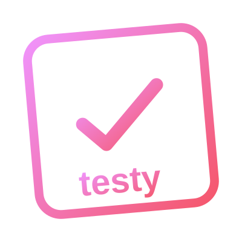

<p align="center">
  
</p>

<p align="center">
  <strong>English</strong> · <a href="README.pt-BR.md">Português (BR)</a>
</p>

# Testy

A testy, opinionated test management tool for QA teams that value simplicity over configuration. Create test plans, write scenarios in Given/When/Then format, generate scenarios with AI, attach evidence, and export PDF reports — nothing more, nothing less.

Most test management tools drown you in fields, workflows, and integrations before you can write your first test case. Testy takes the opposite approach: it gives you exactly what you need and stays out of the way.

## Features

- **Test Plans** — group related scenarios under a named plan assigned to a QA
- **Tags** — categorize plans with tags (e.g. "login", "sprint-23", "regressão") and search by them
- **Scenarios (Given/When/Then)** — structured Gherkin format without the overhead of a full framework
- **AI Scenario Generation** — describe a feature in plain text and let an AI (Gemini, ChatGPT, Claude via API, or the Claude Code already signed in on the machine) generate 5-15 test scenarios automatically, covering happy paths, edge cases, boundary values, and equivalence partitioning
- **Drag & Drop Reorder** — reorder scenarios by dragging them, with smooth FLIP animations and a visual drop zone; order is persisted and reflected in reports
- **Evidence Attachments** — upload screenshots and files directly on each scenario or bug, each with an optional caption that shows up in the PDF
- **One-Click Approve/Reject** — mark scenarios as approved or failed inline
- **Derived Status** — plan status is computed automatically from its scenarios (no manual updates)
- **Projects (workspaces)** — one workspace per application under test; after signing in you pick a project and its test plans, bugs, root causes and AI analyses stay separate from the others (the API takes `project_id`)
- **Bug Tracking** — report bugs with title, description, steps to reproduce, obtained vs expected results, and evidence attachments; tag by feature and root cause; mark as open or resolved
- **AI for bugs** — paste a bug report in free text and the AI fills in the bug form (steps, results, tags reusing the existing ones) for review; on The Root Of All Evil, "Analyze bugs" reads the most frequent bugs and reports the recurring errors and what to improve; each analysis is saved and exports to a LaTeX PDF
- **Bug ↔ Scenario Link** — associate failed scenarios with bugs; a scenario cannot be approved while a bug is linked to it
- **Root Causes Dashboard** — aggregated view of bugs grouped by cause tag and feature tag, with bar charts for quick analysis
- **Search & Filters** — search plans by name, QA, or tag; search bugs by ID, title, or description; filter by status, tags, and date range
- **Pagination** — paginated plan and bug listings for large datasets
- **PDF Reports (LaTeX)** — export test plans, individual bugs and AI bug analyses as LaTeX PDFs (Latin Modern), with a global logo and in the language the app is in
- **Keyboard Shortcuts** — navigate quickly with single-key shortcuts (T for the menu, W for projects, N for new, B for back, R for root causes, P for plans)
- **Authentication & Roles** — username/password login with admin and regular user roles; admins manage all plans and bugs, users manage their own
- **Bilingual (EN / PT-BR)** — full interface in English and Brazilian Portuguese; switch languages with one click, preference saved in cookie
- **REST API** — full JSON API with token authentication for test plans, scenarios, bugs, tags, and screenshot attachments
- **Testy CLI** — AI-powered command-line assistant that manages test plans, executes scenarios in the browser with Playwright, captures screenshots as evidence, and approves or rejects scenarios automatically — all from natural language commands

## Tech Stack

| Layer | Choice |
|-------|--------|
| Framework | Rails 8.1 |
| Ruby | 3.4+ |
| Database | SQLite |
| Frontend | Vanilla CSS, Hotwire (Turbo + Stimulus) |
| File Storage | Active Storage (local disk) |
| PDF | LaTeX (pdflatex) |
| AI | Gemini, OpenAI (ChatGPT), Anthropic (Claude) or local Claude Code CLI |
| CLI | Go (Cobra) + Claude Code (AI mode) |
| Browser Automation | Playwright MCP |
| Deploy | Kamal-ready (Docker + Thruster) |

## Getting Started

**Prerequisites:** Ruby 3.4+ and `pdflatex` for the PDF reports (Debian/Ubuntu: `texlive-latex-extra lmodern`; macOS: MacTeX)

```bash
# Clone the repository
git clone https://github.com/VictorBitancourt/testy.git
cd testy

# Install dependencies
bundle install

# Setup an empty database (db:setup/db:prepare also load the seed's sample data)
bin/rails db:create db:schema:load

# (Optional) AI scenario generation: pick the provider and paste its key in Settings,
# or use environment variables (AI_PROVIDER=gemini|openai|anthropic|claude_cli).
# claude_cli needs no key: it runs `claude -p` with Claude Code's existing login.
export GEMINI_API_KEY=your_key_here   # or OPENAI_API_KEY / ANTHROPIC_API_KEY

# Start the server
bin/dev
```

**macOS:** `bash bin/setup-mac` installs Homebrew, rbenv, the Ruby from `.ruby-version`, the gems and (optionally) MacTeX, then creates the database. Safe to run again.

Open [http://localhost:3000](http://localhost:3000). On first access, you'll be prompted to create the admin user. After signing in you land on **Projects**: create one per application and click it to open its test plans.

## Running Tests

```bash
bin/rails test          # unit, controller and integration tests (PDF tests need pdflatex)
bin/rails test:system   # browser smoke tests (needs Chrome/Chromium)
```

Covers models, controllers, authentication, authorization, filters, projects, AI providers and the LaTeX reports.

## Testy CLI

Testy includes an AI-powered command-line assistant that lets you manage test plans, execute scenarios in the browser, and capture evidence — all from natural language commands.

### Prerequisites

| Requirement | Purpose |
|---|---|
| Go 1.22+ (or pre-built binary) | CLI binary (`cli/bin/testy`) |
| Node.js and `npm install` | Playwright MCP for browser automation (AI mode only) |
| Chromium or Chrome | Browser for screenshots and test execution (AI mode only) |
| [Claude Code](https://docs.anthropic.com/en/docs/claude-code) | AI agent that powers `testy qa` mode (optional) |

### Setup

```bash
# Build the CLI from source (optional — binary may already be built)
cd cli && make build && cd ..

# If the Testy server is running on a different address:
export TESTY_BASE_URL=http://192.168.1.x:3000

# Log in (creates a local token)
bin/testy login <username> <password>
```

### Usage — Direct CLI Commands

The CLI provides direct CRUD commands for all resources:

```bash
# Test plans
bin/testy plans list
bin/testy plans show 1
bin/testy plans create "Login Tests" --qa "Victor"

# Scenarios
bin/testy scenarios create "Valid login" --plan 1 --given "..." --when "..." --then "..."
bin/testy scenarios update 5 --plan 1 --status approved

# Bugs
bin/testy bugs list --status open
bin/testy bugs create "Button broken" --description "..." --steps "..."

# Tags & evidence
bin/testy tags list
bin/testy screenshots attach --plan 1 --scenario 5 --file screenshot.png

# Health check
bin/testy doctor
```

All commands support `--json`, `--md`, and `--quiet` output flags.

> **Projects:** the CLI does not choose a project yet. While the server has a single project it is used automatically; with two or more, `plans create` and `bugs create` are rejected by the API (`project_id` is required) and `plans list` / `bugs list` show every project.

### Usage — AI Mode (testy qa)

For AI-powered test execution with Playwright, you need Claude Code and Node.js:

```bash
# Install Node.js dependencies (Playwright MCP)
npm install

# Interactive AI mode
bin/testy qa

# Single AI command
bin/testy qa "Execute the scenarios of the 'System Login' plan on http://localhost:3000"
```

### What happens when you execute scenarios in AI mode

1. The agent reads the scenario details (Given/When/Then)
2. Opens a browser with Playwright and performs the steps (navigate, click, type)
3. Captures a screenshot of the result and attaches it as evidence
4. Approves or rejects the scenario based on the outcome

### Other CLI commands

```bash
bin/testy logout     # Remove saved token
bin/testy whoami     # Check authentication status
bin/testy commands   # List all available commands
bin/testy version    # Show CLI version
```

### Environment variables

| Variable | Default | Description |
|---|---|---|
| `TESTY_BASE_URL` | `http://localhost:3000` | Testy server URL |
| `TESTY_MODEL` | `sonnet` | Claude model for AI mode (`sonnet`, `opus`, `haiku`) |
| `CHROME_PATH` | Auto-detected | Path to Chromium/Chrome binary (AI mode) |

## How It Works

### Data Model

```
User (username, password_digest, role)
  |
  +-- Session (user_agent, ip_address)

Project (name, description) — one workspace per application
  |
  +-- TestPlan (name, qa_name)
  |     |
  |     +-- TestScenario (title, given, when, then, status, position)
  |     |     |
  |     |     +-- Evidence Files (Active Storage)
  |     |     |
  |     |     +-- Bug (optional link)
  |     |
  |     +-- Tags (many-to-many via TestPlanTag)
  |
  +-- Bug (title, description, steps_to_reproduce, obtained_result, expected_result, status)
  |     |
  |     +-- Evidence Files (Active Storage)
  |     |
  |     +-- feature_tag, cause_tag (free-form tags with autocomplete)
  |     |
  |     +-- TestScenarios (linked failed scenarios)
  |
  +-- BugAnalysis (AI summary, common errors, recommendations)

Setting (report logo, AI provider/model, encrypted API keys) — global
```

### Derived Status

Plan status is not a stored field. It's computed from the scenarios:

| Status | Rule |
|--------|------|
| Not Started | Plan has zero scenarios |
| Approved | All scenarios are `approved` |
| Failed | At least one scenario is `failed` |
| In Progress | Has scenarios, none failed, but not all approved |

A scenario cannot be approved while it has a bug linked to it — the bug must be unlinked or resolved first.

### PDF Export

Each plan has an "Export PDF Report" button that builds the "Evidência de Execução de Testes" document in LaTeX (Latin Modern font) and compiles it with `pdflatex`:
- Cover with the global logo, responsible QA, scenario count, story (plan name) and status: approved only when every scenario is approved, failed as soon as one fails, pending otherwise
- Every scenario with Given/When/Then and its status in bold (red when failed), plus the linked bug when there is one
- Each evidence image on its own page, with the caption typed under it in the app (or the file name). PNG, JPG and PDF are embedded; GIF and WebP show as "unsupported format"

Templates live in `lib/templates/` (`evidence_report.tex`, `bug_report.tex`, `bug_analysis_report.tex`); Testy only replaces their `% testy:...` lines. Labels come from `config/locales/*/reports.yml`, so reports follow the language the app is in. The cover logo is set by an admin under **Settings** (JPG or PNG) and applies to every PDF. `/test_plans/:id/report.tex` and `/bugs/:id/report.tex` download the generated `.tex`.

Requires `pdflatex` with `lmodern`, `tcolorbox`, `xurl`, `lastpage` and `fancyhdr` (Debian/Ubuntu: `texlive-latex-extra lmodern`; macOS: MacTeX). Set `PDFLATEX` to use another binary.

Bugs have their own PDF in the same style: cover (reporter, date, feature, root cause, open/resolved), description, steps to reproduce, obtained and expected results, associated scenarios and captioned evidence.

Each AI bug analysis (The Root Of All Evil → "Analyze bugs") also exports to PDF: summary, top causes and features as bar charts, common errors with the bugs behind them, and recommendations.

## Design Decisions

**No AND between Given, When, and Then.** This is intentional. Each step is a single text field — there's no way to chain multiple clauses with AND.

When tools allow AND, scenarios inevitably turn into click-by-click scripts:

> **Given** the user is on the login page  
> **And** the user has a valid account  
> **And** the browser is Chrome  
> **When** the user clicks the email field  
> **And** types "user@email.com"  
> **And** clicks the password field  
> **And** types "123456"  
> **And** clicks the submit button  
> **Then** the page redirects to /dashboard  
> **And** the welcome message is visible  
> **And** the session cookie is set  

This is not a test scenario — it's a manual test script. It's fragile, unreadable for non-technical stakeholders, and describes *how* instead of *what*.

Testy forces you to write scenarios that describe **behavior**, not **procedure**:

> **Given** a registered user  
> **When** they log in with valid credentials  
> **Then** they are redirected to the dashboard  

One Given, one When, one Then. If you can't describe the scenario in three concise sentences, it's probably more than one scenario. This keeps tests readable by both developers and business people, which is the whole point of Gherkin — a shared language, not a step recorder.

**SQLite in production.** One fewer service to manage. Works great for small-to-medium teams. Rails 8 supports it well with Solid Cache, Solid Queue, and Solid Cable.

**Simple authentication.** Testy uses Rails' built-in `has_secure_password` with username/password login. On first access, you'll be redirected to create the admin user — no seeds or setup scripts needed.

**No JavaScript build step.** Uses import maps for JS and vanilla CSS with CSS layers for styling.

**Server-side filters.** Filtering happens via query params and SQL scopes — no client-side state, no JavaScript complexity, and every filtered view is a shareable URL.

## Deployment

### Docker Compose (recommended)

```bash
git clone https://github.com/VictorBitancourt/testy.git
cd testy
docker compose up -d
```

Open [http://localhost:3000](http://localhost:3000). On first access, you'll be prompted to create the admin user.

Data is persisted in a Docker volume (`testy_storage`). A `SECRET_KEY_BASE` is generated automatically on first boot.

To enable AI scenario generation, set the provider and key in **Settings**, or pass the variables:

```bash
AI_PROVIDER=anthropic ANTHROPIC_API_KEY=your_key_here docker compose up -d
```

### Docker Run

```bash
docker run -d \
  -p 3000:80 \
  -e SOLID_QUEUE_IN_PUMA=true \
  -e FORCE_SSL=false \
  -e ASSUME_SSL=false \
  -e GEMINI_API_KEY=your_key_here \
  -v testy_storage:/rails/storage \
  testy:latest
```

## Password Reset

If a user forgets their password, an admin with server access can reset it:

```bash
bin/rails password:reset
```

The task will prompt for the username and a new password (input is hidden).

For Docker deployments:

```bash
docker exec -it <container_name> bin/rails password:reset
```

## Contributing

1. Fork the repository
2. Create your feature branch (`git checkout -b feature/my-feature`)
3. Make your changes and ensure tests pass (`bin/rails test`)
4. Commit your changes (`git commit -m 'Add my feature'`)
5. Push to the branch (`git push origin feature/my-feature`)
6. Open a Pull Request

## License

This project is open source under the [MIT License](LICENSE).
