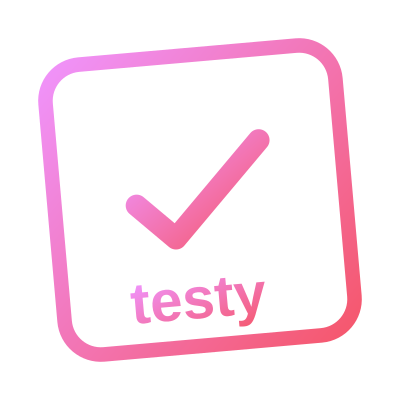

<p align="center">
  
</p>

<p align="center">
  <a href="README.md">English</a> · <strong>Português (BR)</strong>
</p>

# Testy

Testy é uma ferramenta opinativa de gestão de testes para equipes de QA que priorizam simplicidade, praticidade e convenções. Crie planos de teste, escreva cenários no formato Dado que/Quando/Então, gere cenários manualmente ou com IA, anexe evidências e exporte relatórios PDF. Também há uma seção completa de gerenciamento de bugs que segue a mesma filosofia: registre-os e gere bug reports rapidamente. Testy é uma ferramenta feita de QA para QA.

A maioria das ferramentas de gestão de testes são repletas de campos, workflows, configurações e integrações que em nada ajudam o QA a escrever seus testes. O Testy adota outra abordagem: oferece-lhe o que precisa e sai do seu caminho.

## Funcionalidades

- **Planos de Teste** — agrupa cenários relacionados num plano nomeado, atribuído a um QA
- **Tags** — categoriza planos com tags (ex: "login", "sprint-23", "regressão") e pesquisa por elas
- **Cenários (Given/When/Then)** — formato Gherkin estruturado
- **Geração de Cenários com IA** — descreve uma funcionalidade em texto livre e deixa a IA (Gemini, ChatGPT, Claude pela API ou o Claude Code já logado no computador) gerar cenários de teste automaticamente, cobrindo caminhos felizes, casos extremos, valores limite e particionamento de equivalência
- **Drag & Drop para Reordenar** — reordena cenários arrastando-os, com animações FLIP suaves e zona de drop visual; a ordem é persistida e refletida nos relatórios
- **Anexos de Evidências** — faz upload de screenshots diretamente em cada cenário ou bug, cada um com uma legenda opcional que aparece no PDF
- **Aprovar/Reprovar com Um Clique** — marca cenários como aprovados ou falhados inline
- **Status Derivado** — o status do plano é derivado automaticamente a partir dos seus cenários (sem atualizações manuais)
- **Projetos (workspaces)** — um workspace por aplicação testada; depois do login você escolhe o projeto e os planos de teste, bugs, causas raiz e análises de IA dele ficam separados dos outros (a API recebe `project_id`)
- **Registo de Bugs** — reporta bugs com título, descrição, passos para reproduzir, resultado obtido vs esperado e anexos de evidência; classifica por funcionalidade e causa-raiz; marca como aberto ou resolvido
- **IA para bugs** — cola o relato de um bug em texto livre e a IA preenche o formulário (passos, resultados, tags reaproveitando as existentes) para revisão; no The Root Of All Evil, "Analisar bugs" lê os bugs mais frequentes e aponta os erros que se repetem e o que melhorar; cada análise fica salva e exporta para PDF em LaTeX
- **Bug ↔ Cenário** — associa cenários reprovados a bugs
- **Dashboard de Causas-Raiz** — vista de bugs agrupados por tag de causa e tag de funcionalidade, com gráficos de barras para análise rápida de quais são as causas que mais estão originando bugs
- **Pesquisa e Filtros** — pesquisa planos por nome, QA ou tag; pesquisa bugs por ID, título ou descrição; filtra por status, tags e intervalo de datas
- **Paginação** — listagens de planos e bugs paginadas para grandes volumes de dados
- **Relatórios PDF (LaTeX)** — exporta planos de teste, bugs individuais e análises de bugs por IA como PDF em LaTeX (Latin Modern), com logo global e no idioma em que o app está
- **Atalhos de Teclado** — navegue com uma tecla só (T para o menu, W para projetos, N para novo, B para voltar, R para causas raiz, P para planos)
- **Autenticação e Perfis** — login com username/password com perfis de administrador e utilizador comum
- **Bilingue (EN / PT-BR)** — interface completa em inglês e português brasileiro; alterna idiomas com um clique!
- **API REST** — API JSON completa com autenticação por token para planos de teste, cenários, bugs, tags e anexos de screenshots
- **Testy CLI** — cliente de linha de comando para pessoas e agentes de IA: gerencie projetos, planos e cenários de teste, reporte bugs com passos de reprodução e screenshots, cada repositório ligado ao seu workspace (`.testy.json`); o modo IA opcional executa cenários no browser com o Playwright

## Stack Tecnológica

| Camada | Escolha |
|--------|---------|
| Framework | Rails 8.1 |
| Ruby | 3.4+ |
| Base de Dados | SQLite |
| Frontend | Vanilla CSS, Hotwire (Turbo + Stimulus) |
| Armazenamento | Active Storage (disco local) |
| PDF | LaTeX (pdflatex) |
| IA | Gemini, OpenAI (ChatGPT), Anthropic (Claude) ou Claude Code CLI local |
| CLI | Go (Cobra) + Claude Code (modo IA) |
| Automação de Browser | Playwright MCP |
| Deploy | Kamal-ready (Docker + Thruster) |

## Começar

**Pré-requisitos:** Ruby 3.4+ e `pdflatex` para os relatórios PDF (Debian/Ubuntu: `texlive-latex-extra lmodern`; macOS: MacTeX)

```bash
# Clonar o repositório
git clone https://github.com/VictorBitancourt/testy.git
cd testy

# Instalar dependências
bundle install

# Configurar base de dados (vazia; db:setup/db:prepare também carregam os dados de exemplo do seed)
bin/rails db:create db:schema:load

# (Opcional) IA para gerar cenários: escolha o provedor e cole a chave em Configurações,
# ou use variáveis de ambiente (AI_PROVIDER=gemini|openai|anthropic|claude_cli).
# claude_cli não usa chave: roda `claude -p` com o login que o Claude Code já tem.
export GEMINI_API_KEY=your_key_here   # ou OPENAI_API_KEY / ANTHROPIC_API_KEY

# Iniciar o servidor
bin/dev
```

**macOS:** `bash bin/setup-mac` instala Homebrew, rbenv, o Ruby do `.ruby-version`, as gems e (opcionalmente) o MacTeX, e cria o banco. Pode rodar de novo sem problema.

Abre [http://localhost:3000](http://localhost:3000). No primeiro acesso, será solicitada a criação do utilizador administrador. Depois do login você cai em **Projetos**: crie um por aplicação e clique nele para abrir os planos de teste.

## Executar Testes

```bash
bin/rails test          # testes unitários, de controller e integração (os de PDF precisam do pdflatex)
bin/rails test:system   # smoke tests no browser (precisa de Chrome/Chromium)
```

Cobre modelos, controllers, autenticação, autorização, filtros, projetos, provedores de IA e os relatórios LaTeX.

## Testy CLI

O `testy` é um cliente de linha de comando para a API do Testy. Use à mão ou deixe um agente de IA (o Claude Code, por exemplo) usá-lo a partir de qualquer repositório: listar e criar planos e cenários de teste, reportar bugs com o passo a passo de reprodução e screenshots, tudo dentro do projeto (workspace) certo.

### Pré-requisitos

| Requisito | Para quê |
|---|---|
| Go 1.26+ (ou o binário pronto `cli/bin/testy`) | Compilar o CLI |
| Um servidor Testy rodando e um usuário | Todo comando fala com a API dele |
| [Claude Code](https://docs.anthropic.com/en/docs/claude-code), Node.js e Chromium | Só para o `testy qa` (veja o fim desta seção) |

### Instalação

```bash
# Compilar (o binário também está commitado em cli/bin/testy)
cd cli && make build && cd ..

# Colocar no PATH, para funcionar em qualquer repositório
ln -s "$PWD/cli/bin/testy" ~/.local/bin/testy

# Apontar para o servidor (padrão: http://localhost:3000)
export TESTY_BASE_URL=http://192.168.1.20:3000

# Login — o token da API fica salvo em ~/.config/testy/token
testy login victor 's3cret-pass'
testy whoami
testy doctor        # confere token, API, projeto selecionado e skill
```

Dentro deste repositório também dá para chamar `bin/testy`, um wrapper que repassa para o mesmo binário.

### Projetos (workspaces)

Planos de teste e bugs pertencem a um projeto — um por aplicação testada. Todo comando de `plans` e `bugs` trabalha no **projeto selecionado**:

```bash
testy projects list                                  # id, nome, nº de planos e de bugs abertos
testy projects create "Loja Web" --description "Vitrine e checkout"
testy projects create "App Mobile" --use             # cria e já seleciona
testy projects use "Loja Web"                        # seleciona pelo nome (sem diferenciar maiúsculas)...
testy projects use 3                                 # ...ou pelo id
testy projects current                               # qual projeto, e de onde veio a escolha
testy projects use --clear                           # esquece a seleção
```

**Ligar um repositório ao projeto dele.** Rode na raiz do repositório e commite o arquivo:

```bash
cd ~/code/loja-web
testy projects use "Loja Web" --local                # grava o .testy.json
cat .testy.json
# {
#   "project": "Loja Web"
# }
```

A partir daí, qualquer `testy` rodado em qualquer lugar dentro de `~/code/loja-web` (subpastas inclusive) usa o "Loja Web" — inclusive os comandos que um agente de IA roda ali.

O projeto é resolvido nesta ordem (vale o primeiro que existir):

1. `--project <id|nome>` (ou `-p`) no comando: `testy bugs list -p "App Mobile"`
2. Variável `TESTY_PROJECT`: `TESTY_PROJECT=3 testy plans list`
3. O `.testy.json` mais próximo, da pasta atual para cima
4. `testy projects use` (salvo em `~/.config/testy/config.json`)

Sem nada selecionado e com um só projeto no servidor, ele é usado. Com vários, `plans create` / `bugs create` falham pedindo que você escolha um, e `plans list` / `bugs list` mostram todos os projetos.

### Planos e cenários de teste

```bash
testy plans list
testy plans list --status failed                     # approved, failed, in_progress, not_started
testy plans list --search "checkout" --date-from 2026-11-01 --date-until 2026-11-30
testy plans show 12                                  # o plano com todos os cenários
testy plans create "Checkout — compra sem login" --qa "Victor" --tags "checkout,regressao"
testy plans update 12 --name "Checkout — com e sem login" --tags "checkout"
testy plans delete 12

testy scenarios create "Pagar com cartão válido" --plan 12 \
  --given "Um visitante tem um produto no carrinho" \
  --when "Ele paga com o cartão 4242 4242 4242 4242" \
  --then "A página de confirmação mostra o número do pedido"
testy scenarios update 57 --plan 12 --status approved   # pending, approved, failed
testy scenarios update 58 --plan 12 --status failed --bug-id 31
testy scenarios delete 59 --plan 12
testy screenshots attach --plan 12 --scenario 57 --file evidencias/pedido-confirmado.png
```

### Bugs

Um bug completo — descrição, passos exatos, o que aconteceu e o que deveria acontecer, e depois os screenshots:

```bash
testy bugs create "Botão Pagar não faz nada depois de alterar o endereço de entrega" \
  --description "No checkout, depois de editar o endereço de entrega, clicar em Pagar não envia o pedido nem mostra erro." \
  --steps $'1. Acesse /products/42 e clique em "Adicionar ao carrinho"\n2. Abra /checkout sem fazer login\n3. Preencha o endereço e clique em "Continuar"\n4. Clique em "Editar endereço", troque o CEP para 01310-100 e salve\n5. Clique em "Pagar"' \
  --obtained "Nada acontece; o console mostra: TypeError: cart.total is undefined" \
  --expected "O pagamento é enviado e a página de confirmação abre" \
  --feature-tag "checkout" --cause-tag "javascript"
# → mostra o bug criado; digamos que o id seja 31

testy bugs attach 31 --file evidencias/passo4-endereco-editado.png --file evidencias/passo5-pagar-clicado.png
testy bugs show 31                                   # campos + evidências anexadas
```

O `$'...'` faz o shell transformar `\n` em quebras de linha de verdade, então cada passo aparece numa linha.

```bash
testy bugs list --status open                        # open ou resolved
testy bugs list --feature-tag checkout --search "pagar"
testy bugs update 31 --status resolved
testy bugs delete 31
testy tags list --search "check"
```

O `bugs attach` aceita PNG, JPEG, GIF, WebP e PDF. Ele confere se todos os arquivos existem antes de enviar qualquer um.

### Saída e códigos de saída

| Flag | Saída |
|---|---|
| (nenhuma) / `--md` | Tabelas legíveis |
| `--json` / `-j` | Envelope `{"ok": true, "data": ..., "summary": ...}` |
| `--quiet` / `-q`, `--agent` | Só a parte `data`, em JSON — prático para scripts |

```bash
BUG_ID=$(testy bugs create "Busca ignora acentos" --description "Buscar 'cafe' não encontra 'café'" -q | jq .id)
testy bugs attach "$BUG_ID" --file busca.png
```

Os erros seguem o mesmo formato e definem o código de saída: `0` sucesso, `2` uso (argumento faltando, nenhum projeto selecionado, arquivo ilegível), `3` não encontrado, `4` sem login ou token inválido, `5` proibido (só dá para alterar os próprios planos e bugs, a não ser que você seja admin), `6` limite de requisições, `7` rede, `8` validação ou erro do servidor.

### Usando a partir de um agente de IA em outro projeto

Para que um agente do Claude Code trabalhando num dos seus repositórios explore a aplicação com o Playwright e reporte os bugs confirmados no workspace daquele repositório:

1. Instale o `testy` no PATH e faça login (veja **Instalação**).
2. Ligue o repositório ao projeto: `testy projects use "Loja Web" --local`, e commite o `.testy.json`.
3. Dê ao agente a referência do CLI: `testy skill install` grava em `~/.claude/skills/testy/SKILL.md` (ela é atualizada sozinha quando a versão do CLI muda).
4. Adicione o Playwright MCP ao repositório: `claude mcp add playwright -- npx @playwright/mcp@latest`.
5. Descreva o fluxo num Markdown do repositório (regras de exploração, quando um bug conta como confirmado, nomes dos screenshots) e indique esse arquivo ao agente.

Um token no ambiente também funciona, para CI ou containers: `TESTY_API_TOKEN=<token> testy bugs list`.

### Modo IA (`testy qa`)

O `testy qa` abre o Claude Code com os prompts do próprio Testy e o Playwright MCP do `.claude/mcp.json` deste repositório (rode `npm install` antes):

```bash
testy qa generate --url http://localhost:4000 --name "Checkout" --depth quick --user demo --pass demo123
testy qa execute  --plan 12 --url http://localhost:4000 --user demo --pass demo123
testy qa full     --url http://localhost:4000 --name "Checkout" --context "O cartão 4242 4242 4242 4242 sempre aprova" --model opus
```

O `generate` e o `full` criam o plano no projeto selecionado; o `execute` reporta os bugs no projeto do próprio plano.

### Outros comandos

```bash
testy commands       # todos os comandos com as flags
testy logout         # revoga e apaga o token salvo
testy version
testy skill          # imprime a skill do agente (SKILL.md)
```

### Variáveis de ambiente

| Variável | Padrão | Descrição |
|---|---|---|
| `TESTY_BASE_URL` | `http://localhost:3000` | URL do servidor Testy (ou `--url`) |
| `TESTY_API_TOKEN` | — | Token da API; usado no lugar de `~/.config/testy/token` |
| `TESTY_PROJECT` | — | Id ou nome do projeto; tem prioridade sobre o `.testy.json` e o `testy projects use` |
| `XDG_CONFIG_HOME` | `~/.config` | Onde fica a pasta de configuração `testy/` |

## Como Funciona

### Modelo de Dados

```
User (username, password_digest, role)
  |
  +-- Session (user_agent, ip_address)

Project (name, description) — um workspace por aplicação
  |
  +-- TestPlan (name, qa_name)
  |     |
  |     +-- TestScenario (title, given, when, then, status, position)
  |     |     |
  |     |     +-- Ficheiros de Evidência (Active Storage)
  |     |     |
  |     |     +-- Bug (link opcional)
  |     |
  |     +-- Tags (muitos-para-muitos via TestPlanTag)
  |
  +-- Bug (title, description, steps_to_reproduce, obtained_result, expected_result, status)
  |     |
  |     +-- Ficheiros de Evidência (Active Storage)
  |     |
  |     +-- feature_tag, cause_tag (tags livres com autocomplete)
  |     |
  |     +-- TestScenarios (cenários falhados vinculados)
  |
  +-- BugAnalysis (resumo da IA, erros comuns, recomendações)

Setting (logo dos relatórios, provedor/modelo de IA, chaves criptografadas) — global
```

### Status Derivado

O status do plano não é um campo armazenado. É calculado a partir dos cenários:

| Status | Regra |
|--------|-------|
| Não Iniciado | Plano tem zero cenários |
| Aprovado | Todos os cenários estão `approved` |
| Falhado | Pelo menos um cenário está `failed` |
| Em Progresso | Tem cenários, nenhum falhado, mas nem todos aprovados |

Um cenário não pode ser aprovado enquanto tiver um bug vinculado — o bug deve ser desvinculado ou resolvido primeiro.

### Exportação PDF

Cada plano tem um botão "Exportar Relatório PDF" que gera o documento "Evidência de Execução de Testes" em LaTeX (fonte Latin Modern), compilado com `pdflatex`:
- Capa com o logo global, QA responsável, número de cenários, história (nome do plano) e status: aprovado só quando todos os cenários estão aprovados, reprovado se algum foi reprovado, pendente nos outros casos
- Todos os cenários, com Dado que, Quando, Então e a situação em negrito (vermelho quando reprovado), além do bug vinculado quando houver
- Cada evidência em uma página própria, com a legenda digitada no app embaixo da imagem (ou o nome do arquivo). PNG, JPG e PDF são embutidos; GIF e WebP aparecem como "formato não suportado"

Os templates ficam em `lib/templates/` (`evidence_report.tex`, `bug_report.tex` e `bug_analysis_report.tex`). O Testy só substitui as linhas `% testy:...`. Os rótulos vêm de `config/locales/*/reports.yml`, então os relatórios saem no idioma em que o app está. O logo da capa é definido por um admin em **Configurações** (JPG ou PNG) e vale para todos os PDFs. `/test_plans/:id/report.tex` e `/bugs/:id/report.tex` baixam o `.tex` gerado.

Requer `pdflatex` com os pacotes `lmodern`, `tcolorbox`, `xurl`, `lastpage` e `fancyhdr` (Debian/Ubuntu: `texlive-latex-extra lmodern`; macOS: MacTeX). Use `PDFLATEX` para apontar outro binário.

Bugs têm o próprio PDF no mesmo estilo: capa (quem reportou, data, funcionalidade, causa raiz, aberto/resolvido), descrição, passos para reproduzir, resultados obtido e esperado, cenários associados e evidências com legenda.

Cada análise de bugs por IA (The Root Of All Evil → "Analisar bugs") também exporta para PDF: resumo, principais causas e funcionalidades em gráficos de barras, erros comuns com os bugs por trás deles e recomendações.

## Decisões de Design

**Sem E entre Dado que, Quando e Então.** Isto é intencional. Cada passo é um campo de texto único — não há forma de encadear múltiplas cláusulas com E.

Quando ferramentas permitem E, os cenários inevitavelmente transformam-se em scripts clique-a-clique:

> **Dado que** o utilizador está na página de login  
> **E** o utilizador tem uma conta válida  
> **E** o browser é Chrome  
> **Quando** o utilizador clica no campo de email  
> **E** escreve "user@email.com"  
> **E** clica no campo de password  
> **E** escreve "123456"  
> **E** clica no botão de submit  
> **Então** a página redireciona para /dashboard  
> **E** a mensagem de boas-vindas está visível  
> **E** o cookie de sessão está definido  

Isto não é um cenário de teste — é um script de teste manual. É frágil, ilegível para stakeholders não-técnicos, e descreve *como* em vez de *o quê*.

O Testy obriga o QA a escrever cenários que descrevem **comportamento**, não **procedimento**:

> **Dado que** um utilizador registado  
> **Quando** faz login com credenciais válidas  
> **Então** é redirecionado para o dashboard  

Um Dado que, um Quando, um Então. Se o QA não conseguir descrever o cenário em três frases concisas, provavelmente se trata de mais de um cenário. Isto mantém os testes legíveis tanto para desenvolvedores quanto para pessoas de negócio, que é o propósito do Gherkin — uma linguagem comum, não um roteiro de cliques.

**SQLite em produção.** Menos um serviço para gerir. Funciona bem para equipes pequenas a médias. O Rails 8 suporta-o bem com Solid Cache, Solid Queue e Solid Cable.

**Autenticação simples.** O Testy usa o `has_secure_password` nativo do Rails com login por username/password. No primeiro acesso, o usuário será redirecionado para criar o utilizador admin — sem seeds nem scripts de setup.

**Sem build step de JavaScript.** Usa import maps para JS e vanilla CSS com CSS layers para estilização.

**Filtros server-side.** A filtragem acontece via query params e scopes SQL — sem estado client-side, sem complexidade JavaScript, e cada vista filtrada é um URL partilhável.

## Deployment

### Docker Compose (recomendado)

```bash
git clone https://github.com/VictorBitancourt/testy.git
cd testy
docker compose up -d
```

Abre [http://localhost:3000](http://localhost:3000). No primeiro acesso, será solicitada a criação do utilizador administrador.

Os dados são persistidos num volume Docker (`testy_storage`). Um `SECRET_KEY_BASE` é gerado automaticamente no primeiro uso.

Para ativar a geração de cenários com IA, configure o provedor e a chave em **Configurações**, ou passe as variáveis:

```bash
AI_PROVIDER=anthropic ANTHROPIC_API_KEY=your_key_here docker compose up -d
```

### Docker Run

```bash
docker run -d \
  -p 3000:80 \
  -e SOLID_QUEUE_IN_PUMA=true \
  -e FORCE_SSL=false \
  -e ASSUME_SSL=false \
  -e GEMINI_API_KEY=your_key_here \
  -v testy_storage:/rails/storage \
  testy:latest
```

## Reset de Password

Se um utilizador esquecer a senha, um admin com acesso ao servidor pode fazer reset:

```bash
bin/rails password:reset
```

A task vai pedir o username e uma nova senha.

Para deployments Docker:

```bash
docker exec -it <container_name> bin/rails password:reset
```

## Contribuir

1. Faça fork do repositório
2. Crie a tua branch de feature (`git checkout -b feature/my-feature`)
3. Faça as suas alterações e garanta que os testes passam (`bin/rails test`)
4. Faça commit das alterações (`git commit -m 'Add my feature'`)
5. Faça push para a branch (`git push origin feature/my-feature`)
6. Abra um Pull Request

## Licença

Este projeto é open source sob a [Licença MIT](LICENSE).
